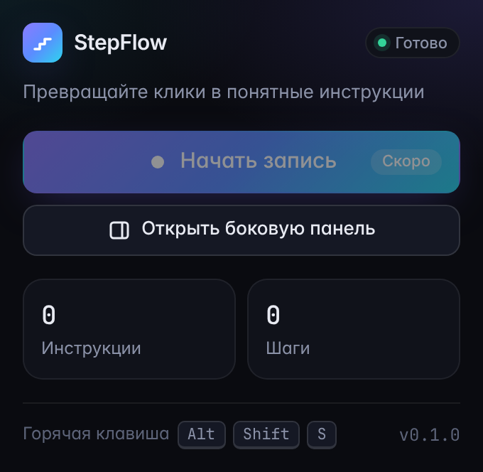
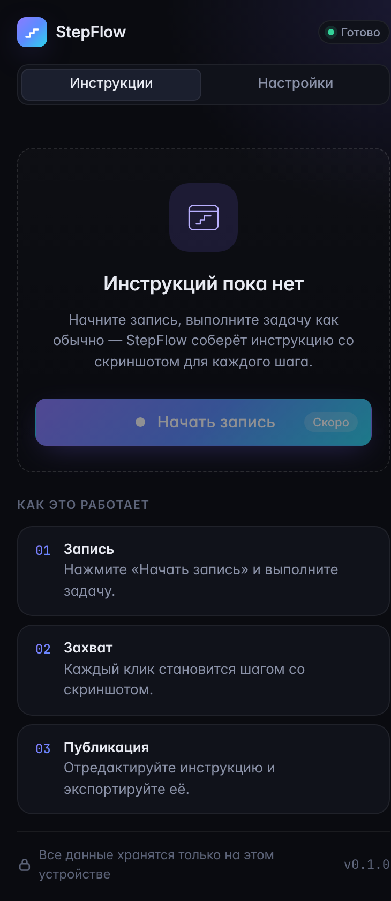

# StepFlow

Chrome-расширение, которое записывает действия пользователя в браузере, автоматически делает скриншоты и превращает их в пошаговые инструкции.

> **Статус: v0.1.0 — Recording MVP в разработке.** Реализованы доменное ядро, запуск записи из popup, внедрение content script в активную вкладку и локальное сохранение безопасных описаний кликов. Остановка, сохранение готовой инструкции и отображение шагов в панели — следующие задачи.

<p>
  
  &nbsp;
  
</p>

## Возможности текущей версии

- **Popup** по клику на иконку или по `Alt+Shift+S`: запуск записи на активной HTTP(S)-странице и открытие боковой панели.
- **Боковая панель** (Side Panel API): список инструкций с пустым состоянием, блок «Как это работает», вкладка настроек.
- **Запись кликов:** учитываются только доверенные клики по поддерживаемым интерактивным элементам; черновик хранится локально в `chrome.storage.local`.
- **Приватность:** значения полей, пароли, содержимое форм, текст страницы, HTML, URL-пути, query и fragment не записываются.
- **Настройки** сохраняются в `chrome.storage.local` и синхронизируются между открытыми окнами.
- **Локализация** `en` и `ru` через `chrome.i18n`. Язык берётся из языка браузера.
- Без сервера, без внешних запросов, без сторонних библиотек и шрифтов.

## Как тестировать

Есть три независимых способа. Ни один не требует корпоративного Chrome.

| Способ | Что нужно | Когда подходит |
|--------|-----------|----------------|
| [A. Отдельный Chromium одной командой](#a-отдельный-chromium-одной-командой) | Node.js 22+ | Ручная проверка на своём компьютере |
| [B. Готовая сборка из GitHub Actions](#b-готовая-сборка-из-github-actions) | Любой Chromium / Chrome | Проверка без Node.js и без клонирования |
| [C. Загрузка вручную](#c-загрузка-вручную-в-chromium-или-chrome) | Chromium, Chrome for Testing или обычный Chrome | Классический способ |

Корпоративные политики Chrome (запрет режима разработчика, белые списки расширений) применяются к установленному Google Chrome и его профилю. Chromium из Playwright и Chrome for Testing — отдельные браузеры с отдельным временным профилем, поэтому эти политики их обычно не затрагивают. Если на компьютере политики настроены и для Chromium, используйте способ B на личном устройстве.

### A. Отдельный Chromium одной командой

```bash
git clone https://github.com/Da1tana/stepflow.git
cd stepflow
npm install              # ставит только Playwright (dev-зависимость)
npm run setup:browser    # один раз скачивает Chromium (~150 МБ) в кеш Playwright
npm run chromium         # открывает Chromium с уже загруженным StepFlow
```

Откроется отдельное окно Chromium: режим разработчика включать не нужно, ваш основной браузер и его профиль не затрагиваются. Нажмите на значок пазла, закрепите StepFlow и кликните по иконке.

- Состояние (настройки, будущие инструкции) сохраняется в `.chromium-profile/`. Чистый старт: `npm run chromium -- --fresh`.
- Свой бинарник Chromium или Chrome for Testing: `CHROMIUM_PATH=/путь/к/chrome npm run chromium`.
- Интерфейс на английском: `LOCALE=en-US npm run chromium`.

### B. Готовая сборка из GitHub Actions

Каждый push и PR собирает расширение и прогоняет тесты в Chromium.

1. Откройте вкладку **Actions** репозитория → нужный запуск **CI**.
2. Внизу в **Artifacts** скачайте `stepflow-extension` (сборка) и, при желании, `screenshots` (скриншоты всех экранов из тестов).
3. Распакуйте архив и загрузите папку по шагам способа C.

### C. Загрузка вручную в Chromium или Chrome

Подойдёт обычный [Chromium](https://www.chromium.org/getting-involved/download-chromium/), [Chrome for Testing](https://googlechromelabs.github.io/chrome-for-testing/) или Chrome на личном компьютере. Нужна версия 116 или новее (для `chrome.sidePanel.open`).

1. Склонируйте репозиторий:
   ```bash
   git clone https://github.com/Da1tana/stepflow.git
   ```
2. Откройте `chrome://extensions`.
3. Включите **Режим разработчика** (переключатель справа вверху).
4. Нажмите **Загрузить распакованное расширение** и выберите папку, где лежит `manifest.json`: корень репозитория, `dist/stepflow` после `npm run pack` или распакованный артефакт из способа B.
5. Закрепите StepFlow на панели расширений (иконка пазла → значок булавки).

Сборка не нужна: расширение работает напрямую из исходников. `npm run pack` лишь копирует в `dist/stepflow/` только файлы расширения (без `node_modules`, тестов и документации), чтобы их было удобно заархивировать и передать на другой компьютер.

Без интерфейса `chrome://extensions` расширение можно подключить флагом запуска. Это работает в Chromium и Chrome for Testing (в обычном Google Chrome 137+ флаг `--load-extension` отключён):

```bash
chromium --user-data-dir=/tmp/stepflow-profile --load-extension=/путь/к/stepflow
```

После изменений в коде нажмите кнопку **↻ Обновить** на карточке StepFlow в `chrome://extensions`, затем заново откройте popup или панель.

## Ручная проверка

| # | Действие | Ожидаемый результат |
|---|----------|---------------------|
| 1 | Загрузить расширение | Нет ошибок на карточке в `chrome://extensions`, кнопка «Ошибки» отсутствует |
| 2 | Клик по иконке StepFlow | Открывается тёмный popup: логотип, статус «Готово», счётчики `0`, версия `v0.1.0` |
| 3 | Нажать `Alt+Shift+S` на любой вкладке | Открывается тот же popup |
| 4 | В popup нажать «Открыть боковую панель» | Popup закрывается, справа открывается панель StepFlow |
| 5 | В панели открыть вкладку «Настройки», переключить тумблер, закрыть и снова открыть панель | Состояние тумблера сохранилось |
| 6 | На обычной HTTP(S)-странице открыть popup и нажать «Начать запись» | Popup открывает боковую панель, а черновик записи создаётся локально; на внутренних страницах браузера запись недоступна |
| 7 | Сменить язык Chrome на English и перезапустить браузер | Весь интерфейс на английском |

### Где смотреть логи

- **Service worker:** `chrome://extensions` → StepFlow → ссылка «service worker» → Console.
- **Popup:** правый клик по popup → «Просмотреть код».
- **Боковая панель:** правый клик внутри панели → «Просмотреть код».

Все сообщения расширения начинаются с префикса `[StepFlow][<контекст>]`.

## Автоматические проверки

Нужен Node.js 22+. Единственная dev-зависимость — Playwright, и только для e2e. В само расширение она не попадает.

```bash
npm run validate     # статическая проверка manifest, разрешений, путей, i18n, CSP (без зависимостей)
npm test             # юнит-тесты доменной логики (node:test, без зависимостей)
npm run check        # validate + test

npm run test:e2e     # загружает расширение в headless Chromium и проверяет popup и панель
HEADED=1 npm run test:e2e   # то же, но с видимым окном
npm run check:all    # всё вместе
```

E2E-тесты прогоняются на английском и русском интерфейсе и проверяют: запуск service worker и инициализацию хранилища, отрисовку popup и счётчиков, открытие боковой панели кнопкой из popup, вкладки и сохранение настроек после перезагрузки, живое обновление списка инструкций из хранилища, отсутствие ошибок в консоли и непереведённых строк. Скриншоты каждого экрана сохраняются в `test-results/`.

`scripts/validate.mjs` проверяет:

- `manifest_version: 3`, нет устаревших ключей (`browser_action`, `background.scripts`, `persistent`);
- каждое разрешение есть в белом списке с обоснованием, нет `host_permissions` и `content_scripts`, не переопределён CSP;
- все файлы, на которые ссылается manifest и HTML, существуют, все относительные `import` разрешаются;
- нет inline-скриптов, inline-обработчиков, `eval` и удалённых ресурсов (запрещены в MV3);
- все ключи локализации определены, а локали `en` и `ru` содержат одинаковый набор ключей.

## Разрешения

| Разрешение | Зачем |
|------------|-------|
| `sidePanel` | Показ боковой панели StepFlow |
| `storage` | Локальное хранение настроек, черновика записи и инструкций (`chrome.storage.local`) |
| `activeTab` | Временный доступ к активной вкладке после явного открытия popup пользователем |
| `scripting` | Внедрение recorder-скрипта только в эту временно разрешённую вкладку |

Нет постоянного доступа к сайтам (`host_permissions`), разрешения `tabs`, истории или сети. `activeTab` даёт временный доступ только после действия пользователя; `scripting` используется для разового внедрения recorder-скрипта. Новые разрешения добавляются только вместе с функцией, которой они нужны, и сначала вносятся в белый список в `scripts/validate.mjs` и в эту таблицу.

## Структура проекта

```
stepflow/
├── manifest.json               # Manifest V3
├── _locales/{en,ru}/           # Тексты интерфейса (chrome.i18n)
├── assets/icons/               # Иконки 16/32/48/128
├── src/
│   ├── background/
│   │   ├── service-worker.js   # Точка входа фона: роутер сообщений, жизненный цикл
│   │   └── handlers/           # Обработчики сообщений по доменам (app.js, позже recording.js …)
│   ├── core/                   # Чистая доменная логика без chrome.* (модель инструкции)
│   ├── content/                # Recorder, внедряемый по запросу пользователя
│   ├── popup/                  # Popup: html/css/js
│   ├── sidepanel/              # Боковая панель: html/css/js
│   └── shared/
│       ├── js/                 # constants, messaging, storage, i18n, logger
│       └── styles/             # tokens.css (дизайн-токены), base.css, components.css
├── scripts/
│   ├── validate.mjs            # Статическая проверка расширения
│   ├── chromium.mjs            # npm run chromium — отдельный Chromium со StepFlow
│   └── pack.mjs                # npm run pack — чистая сборка в dist/stepflow
├── tests/
│   ├── unit/                   # Юнит-тесты доменной логики (node --test)
│   └── e2e/                    # Тесты в настоящем Chromium (Playwright)
├── .github/workflows/ci.yml    # CI: проверки, тесты, артефакты сборки и скриншотов
└── docs/                       # Архитектура и скриншоты
```

Подробно об архитектуре и о том, как добавлять функции: [docs/ARCHITECTURE.md](docs/ARCHITECTURE.md).

## Дорожная карта

1. **Завершение Recording MVP:** остановка и сохранение инструкции, отмена черновика, live-список шагов, обработка навигации и закрытия вкладки.
2. **Скриншоты:** `chrome.tabs.captureVisibleTab`, подсветка элемента, хранение изображений в IndexedDB.
3. **Редактор инструкции:** отдельная страница расширения, перестановка и правка шагов.
4. **Экспорт:** HTML, Markdown, PDF — полностью локально.

## Лицензия

[MIT](LICENSE)
